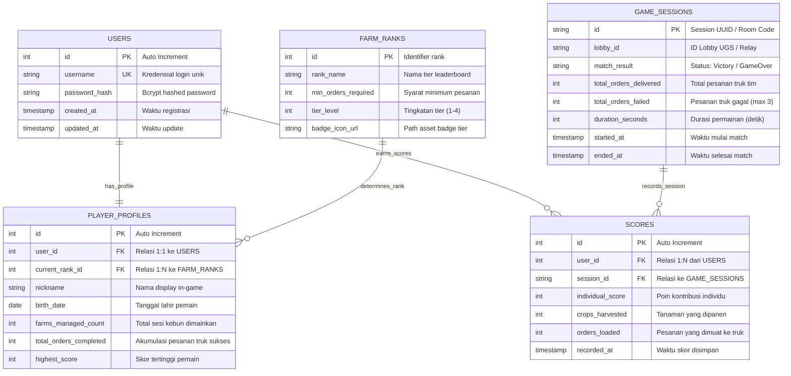

# Game Backend REST API - Modul 8

Implementasi backend service lokal menggunakan Node.js dan Express.js untuk arsitektur game client-server berbasis REST API (Modul 8 Praktikum Pemrograman Game Jaringan).

---

## 🛠️ Tech Stack & Dependensi
- **Node.js** & **Express.js** (Web Server Framework)
- **cors** (Cross-Origin Resource Sharing untuk Game Client Unity)
- **dotenv** (Manajemen Environment Variable)
- **nodemon** (Dev Dependency - Auto-reload server)

---

## 🚀 Cara Menjalankan Server

### 1. Install Dependencies
```bash
npm install
```

### 2. Setup Environment Variable
Duplikasi file `.env.example` menjadi `.env`:
```bash
cp .env.example .env
```
Default PORT: `5000`

### 3. Menjalankan Server
- **Mode Development (dengan nodemon):**
  ```bash
  npm run dev
  ```
- **Mode Production:**
  ```bash
  npm start
  ```

Server akan aktif di: `http://localhost:5000`

---

## 📋 Spesifikasi Endpoint API (API Contract)

| HTTP Method | Endpoint | Fungsi | Payload Input (JSON) | Status Code | Output Response |
| :--- | :--- | :--- | :--- | :--- | :--- |
| **GET** | `/api/health` | Health Check Server | *(None)* | `200 OK` | `{"status":"success","message":"...","serverTime":"..."}` |
| **POST** | `/api/register` | Draft Registrasi Akun | `{"username":"string","password":"string"}` | `501 Not Implemented` | `{"message":"Endpoint /api/register belum diimplementasikan"}` |
| **POST** | `/api/login` | Draft Login Pemain | `{"username":"string","password":"string"}` | `501 Not Implemented` | `{"message":"Endpoint /api/login belum diimplementasikan"}` |
| **POST** | `/api/score/save` | Draft Simpan Skor | `{"userId":1,"score":100}` | `501 Not Implemented` | `{"message":"Endpoint /api/score/save belum diimplementasikan"}` |
| **GET** | `/api/leaderboard`| Draft Papan Skor | *(None)* | `501 Not Implemented` | `{"message":"Endpoint /api/leaderboard belum diimplementasikan"}` |

---

## 🗄️ Perancangan Database (ERD - Eden Farm)

Arsitektur database relasional ternormalisasi (3NF) untuk mendukung fitur akun, profil pemain, tier leaderboard (*farm-rank*), dan sesi multiplayer bersama (*scores & game sessions*). Dokumentasi detail tersedia di [`docs/ERD.md`](./docs/ERD.md).



---

## 🧪 Pengujian API (Health Check)

### Menggunakan cURL:
```bash
curl http://localhost:5000/api/health
```

### Menggunakan Browser / Postman:
Akses URL: [http://localhost:5000/api/health](http://localhost:5000/api/health)

---

## 📮 Postman Workspace & Automated CLI Testing

File konfigurasi Postman tersedia di folder [`postman/`](./postman):
- **Collection:** `postman/Game_Backend_Modul8.postman_collection.json`
- **Environment:** `postman/Local_Environment.postman_environment.json`

### Menjalankan Pengujian Otomatis via Postman CLI (Newman):
Pastikan server sedang berjalan (`npm run dev`), lalu di terminal lain jalankan:

```bash
# Menjalankan seluruh test suite (Health Check & semua Endpoint)
npm test

# Atau hanya menguji endpoint Health Check
npm run test:health
```

### Import ke Postman GUI Desktop:
1. Buka aplikasi **Postman**.
2. Klik tombol **Import** di pojok kiri atas workspace Anda.
3. Pilih file `postman/Game_Backend_Modul8.postman_collection.json` dan `postman/Local_Environment.postman_environment.json`.
4. Pilih environment **Local Backend Environment** di kanan atas Postman.
5. Jalankan collection via **Run Collection** untuk melihat hasil visual test runner.

