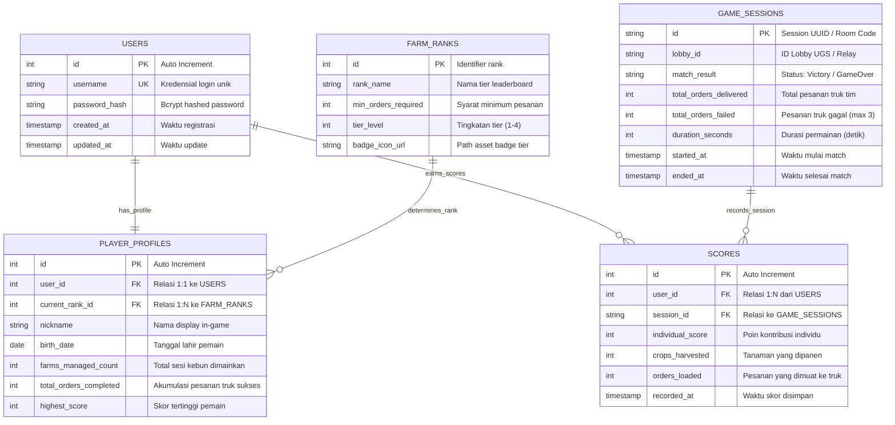

# 🌾 Database Entity Relationship Diagram (ERD) - Eden Farm

Dokumen perancangan basis data relasional (*3NF Normalized Architecture*) untuk game multiplayer **Eden Farm**, mencakup manajemen akun autentikasi, profil pemain & statistik, tingkatan tier (*farm-rank*), sesi permainan ruang (*multiplayer lobby/room*), dan riwayat perolehan skor.

---

## 📊 Visual ERD Diagram (Mermaid)



---

## 🗄️ Kamus Data (Data Dictionary)

### 1. Entitas `USERS` (Autentikasi Akun)
Menyimpan data identitas kredensial login akun secara aman:
| Kolom | Tipe Data | Constraint | Deskripsi |
| :--- | :--- | :--- | :--- |
| `id` | `INT` | PK, AUTO_INCREMENT | Identifier unik akun. |
| `username` | `VARCHAR(50)` | UNIQUE, NOT NULL | Nama pengguna untuk login. |
| `password_hash` | `VARCHAR(255)` | NOT NULL | Password terenkripsi (*bcrypt*). |
| `created_at` | `TIMESTAMP` | DEFAULT CURRENT_TIMESTAMP | Waktu pendaftaran akun. |
| `updated_at` | `TIMESTAMP` | ON UPDATE CURRENT_TIMESTAMP | Waktu modifikasi terakhir. |

### 2. Entitas `PLAYER_PROFILES` (Biodata & Progres Gameplay)
Menyimpan profil publik serta statistik agregat perkembangan bertani:
| Kolom | Tipe Data | Constraint | Deskripsi |
| :--- | :--- | :--- | :--- |
| `id` | `INT` | PK, AUTO_INCREMENT | Identifier profil. |
| `user_id` | `INT` | FK (USERS.id), UNIQUE | Relasi 1:1 dengan akun pengguna. |
| `current_rank_id` | `INT` | FK (FARM_RANKS.id) | Tingkatan rank saat ini. |
| `nickname` | `VARCHAR(50)` | NOT NULL | Nama display yang tampil di game. |
| `birth_date` | `DATE` | NULLABLE | Tanggal lahir pemain. |
| `farms_managed_count` | `INT` | DEFAULT 0 | Jumlah sesi kebun yang dikelola (*farm-managed*). |
| `total_orders_completed` | `INT` | DEFAULT 0 | Total akumulasi pesanan truk yang berhasil diantar. |
| `highest_score` | `INT` | DEFAULT 0 | Skor terbaik yang pernah dicapai. |

### 3. Entitas `FARM_RANKS` (Master Lookup Table Tier)
Master data acuan jenjang tier leaderboard game:
| Kolom | Tipe Data | Constraint | Deskripsi |
| :--- | :--- | :--- | :--- |
| `id` | `INT` | PK | `1: Novice`, `2: Apprentice`, `3: Master`, `4: Legend`. |
| `rank_name` | `VARCHAR(30)` | NOT NULL | Contoh: *Novice Planter*, *Eden Legend*. |
| `min_orders_required` | `INT` | NOT NULL | Batas minimal order untuk mencapai rank ini. |
| `tier_level` | `INT` | NOT NULL | Urutan numerik hierarki rank. |
| `badge_icon_url` | `VARCHAR(255)` | NULLABLE | Path asset ikon in-game. |

### 4. Entitas `GAME_SESSIONS` (Ruang Match Multiplayer)
Mencatat sesi kebun multiplayer bersama (berkaitan dengan FishNet / UGS Lobby):
| Kolom | Tipe Data | Constraint | Deskripsi |
| :--- | :--- | :--- | :--- |
| `id` | `VARCHAR(64)` | PK | Session ID / Kode Room permainan. |
| `lobby_id` | `VARCHAR(128)` | NULLABLE | ID Lobby pada server Relay. |
| `match_result` | `VARCHAR(20)` | NOT NULL | Status akhir: `'Victory'` atau `'GameOver'`. |
| `total_orders_delivered`| `INT` | DEFAULT 0 | Jumlah total pesanan truk yang sukses dipenuhi tim. |
| `total_orders_failed` | `INT` | DEFAULT 0 | Jumlah pesanan yang hangus/gagal (maks 3). |
| `duration_seconds` | `INT` | DEFAULT 0 | Durasi bermain hingga game over / victory. |
| `started_at` | `TIMESTAMP` | NOT NULL | Waktu sesi match dimulai. |
| `ended_at` | `TIMESTAMP` | DEFAULT CURRENT_TIMESTAMP | Waktu sesi match berakhir. |

### 5. Entitas `SCORES` (Pencatatan Skor Individu)
Menyimpan riwayat skor kontribusi setiap pemain pada tiap sesi match:
| Kolom | Tipe Data | Constraint | Deskripsi |
| :--- | :--- | :--- | :--- |
| `id` | `INT` | PK, AUTO_INCREMENT | Identifier record perolehan skor. |
| `user_id` | `INT` | FK (USERS.id), NOT NULL | ID pemain (memenuhi relasi 1:N dari USERS). |
| `session_id` | `VARCHAR(64)` | FK (GAME_SESSIONS.id) | ID sesi match tempat skor dicetak. |
| `individual_score` | `INT` | DEFAULT 0 | Skor kontribusi pemain. |
| `crops_harvested` | `INT` | DEFAULT 0 | Banyaknya tanaman yang berhasil dicangkul/dipanen. |
| `orders_loaded` | `INT` | DEFAULT 0 | Banyaknya item yang dimasukkan ke box truk. |
| `recorded_at` | `TIMESTAMP` | DEFAULT CURRENT_TIMESTAMP | Waktu pencatatan skor. |

---

## 💻 Cara Menggunakan di draw.io / diagrams.net

1. Buka [https://app.diagrams.net](https://app.diagrams.net).
2. Pilih **Create New Diagram** ➔ **Blank Diagram**.
3. Di bilah menu atas, klik:
   ```text
   Arrange ➔ Insert ➔ Advanced ➔ Mermaid
   ```
4. Salin dan tempel blok kode Mermaid di atas (mulai dari `erDiagram` hingga kurung kurawal terakhir).
5. Klik tombol **Insert**.
6. Diagram akan langsung tersusun rapi menjadi bentuk visual grafis yang siap diatur tata letaknya dan diekspor ke format **PNG, PDF, atau SVG**.
